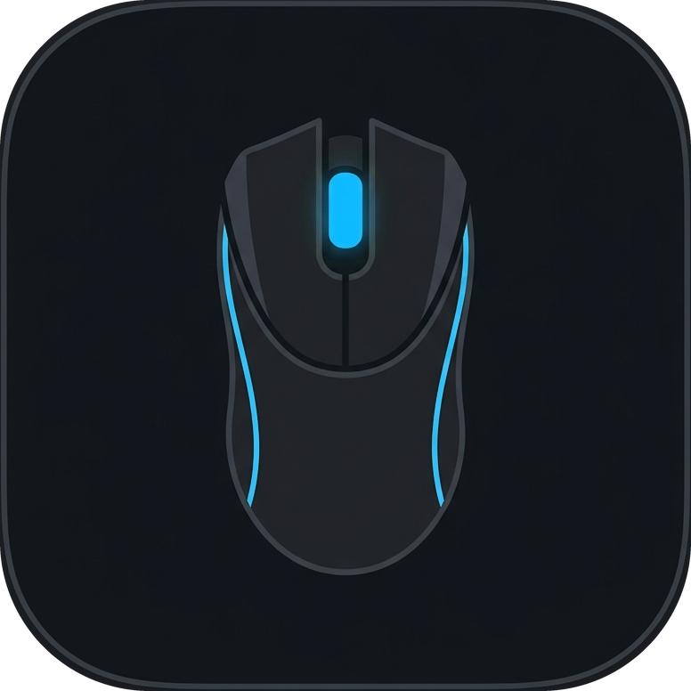

# Razer Diamondback Controller

  

  <strong>Lightweight standalone utility for the Razer Diamondback 2015 Chroma (USB) gaming mouse.</strong> 
  Direct hardware control via USB HID protocol — <em>no bulky Razer Synapse required</em>.

  <a href="#english">English</a> • <a href="#русский">Русский</a>

---

## 🌐 English

### ⚡ Overview
**Razer Diamondback Controller** is a high-performance, minimalist Windows application designed to configure and control the **Razer Diamondback 2015 Chroma** gaming mouse directly at the hardware USB HID level. It completely replaces the heavy and resource-intensive Razer Synapse software.

### 🚀 Key Features

1. **DPI Sensitivity Control:**
   - Smooth on-the-fly adjustment from **100 to 16,000 DPI** using an interactive slider.
   - Quick one-click presets: **400**, **800**, **1200**, **1600**, **2400**, **3200**.
   - Directly writes values into the mouse sensor's onboard memory.

2. **USB Polling Rate:**
   - **125 Hz** (8 ms • Office / Power-efficient)
   - **500 Hz** (2 ms • Fast)
   - **1000 Hz** (1 ms • Esports / Ultra-low tournament latency)

3. **Chroma RGB Lighting:**
   - **Static Mode:** Set any solid color across all mouse LEDs (side light strips, scroll wheel, and logo).
   - **Spectrum Cycling (🌈):** Hardware-driven smooth rainbow spectrum cycling effect.
   - **Turn Off:** Instant clean toggle to shut down all mouse LEDs.
   - **Interactive Rainbow Spectrum Bar:** Smooth continuous drag-to-pick hue gradient + instant reference chips (Carist Blue `#1CA8DE`, Razer Green `#00E65B`, Coral Red `#FF3C3C`, Pure White `#F0F0F0`).
   - Custom Windows color dialog (`🎨 Custom...`) for full 16.7M color selection.

4. **☀ Real-time Brightness Control (0% – 100%):**
   - Real-time hardware PWM duty-cycle brightness slider.
   - Live percentage readout (`0%` to `100%`).
   - Automatically saves brightness preference in the Windows Registry.
   - Quick tray presets (`100%`, `75%`, `50%`, `25%`, `0%`).
   - At 0%, LEDs cleanly turn off; increasing brightness instantly restores the active color.

5. **Multi-language Auto-adaptation:**
   - The UI automatically adapts to your Windows display language: **English**, **Ukrainian**, or **Russian**.

6. **System Tray & Auto-run:**
   - Minimizes cleanly to the Windows notification tray next to the clock.
   - Full-featured tray context menu for quick switching of DPI, polling rate, lighting mode, and brightness presets.
   - Optional automatic launch with Windows (`--tray` background mode).

7. **Sensor Information:**
   - Displays real-time status and recognizes the **Philips Twin-Eye PLN 2034** (Razer 5G Laser Sensor, up to 16,000 DPI).

### 📥 Download & Usage
- Download **`RazerDiamondbackSetup.exe`** from the repository to install the application with shortcuts and an uninstaller.
- Or run **`RazerDiamondbackController.exe`** as a fully portable, standalone app with no installation required.

### 🛠 Building from Source
- Compile executable: run `build.bat` (uses standard .NET Framework `csc.exe`, no Visual Studio needed).
- Build Inno Setup installer: run `build_installer.bat` (requires Inno Setup 6).

---

## 🇷🇺 Русский

### ⚡ Обзор
Легковесная автономная утилита для полной настройки мыши **Razer Diamondback 2015 Chroma (USB)** напрямую через протокол USB HID — **без необходимости устанавливать или держать запущенным Razer Synapse**.

### 🚀 Возможности программы

1. **Управление чувствительностью (DPI):**
   - Плавная регулировка от 100 до 16 000 DPI интерактивным ползунком.
   - Быстрые пресеты популярных значений: **400**, **800**, **1200**, **1600**, **2400**, **3200**.
   - Прямая запись во встроенную память сенсора.

2. **Частота опроса USB (Polling Rate):**
   - **125 Гц** (8 мс • Офис)
   - **500 Гц** (2 мс • Быстро)
   - **1000 Гц** (1 мс • Esports / Турнирный режим)

3. **Управление Chroma RGB подсветкой:**
   - **«Статика»** — чистый ровный цвет на всех светодиодах мыши (боковые полосы корпуса, колесо, логотип).
   - **«🌈 Спектр»** — встроенный аппаратный эффект циклического переливания всех цветов радуги (Spectrum Cycling) с плавным градиентом.
   - **«Выкл»** — мгновенное и чистое отключение всех светодиодов на мыши.
   - **Интерактивная шкала спектра:** плавный выбор любого оттенка градиента + быстрые цвета (Синий Carist `#1CA8DE`, Зеленый Razer `#00E65B`, Коралловый `#FF3C3C`, Чистый белый `#F0F0F0`).
   - Кнопка «🎨 Другой...»: выбор любого из 16.7 млн цветов через цветовую палитру Windows.

4. **☀ Регулировка яркости подсветки (0% – 100%):**
   - Аппаратная регулировка яркости (PWM) ползунком в реальном времени.
   - Цифровая индикация текущего процента яркости (`0%` – `100%`).
   - Автоматическое сохранение уровня яркости в реестре Windows.
   - Быстрые пресеты яркости в контекстном меню трея (`100%`, `75%`, `50%`, `25%`, `0%`).
   - При 0% подсветка полностью гаснет, при повышении — мгновенно активируется.

5. **Автоматическая адаптация языка:**
   - Язык интерфейса автоматически подстраивается под язык Windows: **Русский**, **Украинский**, **Английский**.

6. **Системный трей и автозагрузка:**
   - Сворачивание в трей рядом с часами при закрытии или минимизации.
   - Быстрое контекстное меню в трее для смены DPI, частоты опроса, цвета, спектра и яркости.
   - Опция запуска вместе с Windows (`--tray`).

7. **Информация о сенсоре:**
   - В карточке статуса отображается установленный сенсор: **Philips Twin-Eye PLN 2034** (Razer 5G Laser Sensor, 16 000 DPI).

---

## 📦 Файлы проекта

Все файлы сохранены в папке:
`C:\Users\rusua\Desktop\Projects\RazerDiamondbackController`

- **`RazerDiamondbackSetup.exe`** — готовый установочный файл (Installer) для чистой установки приложения в систему с ярлыками и деинсталлятором.
- **`RazerDiamondbackController.exe`** — готовая автономная программа управления DPI, герцовкой, подсветкой и яркостью.
- **`MainWindow.cs`** — современный киберспортивный интерфейс WPF с неоновым свечением, кастомными ползунками и анимациями.
- **`RazerHardware.cs`** — драйвер прямого протокола USB HID Feature Reports для Razer Diamondback Chroma.
- **`Program.cs`** — точка входа с защитой от запуска повторных копий (Mutex).
- **`installer.iss`** — скрипт сборщика Inno Setup 6.
- **`build_installer.bat`** — скрипт автоматической перекомпиляции программы и сборки инсталлятора в 1 клик.
- **`build.bat`** — скрипт быстрой компиляции `.exe` через встроенный `csc.exe`.
- **`app.ico`** — многослойная иконка приложения.
- **`tg_icon.png`** / **`app_icon.png`** — графические ресурсы.

---

## 👨‍💻 Автор / Author
- Telegram: [@Carist](https://t.me/Carist)
